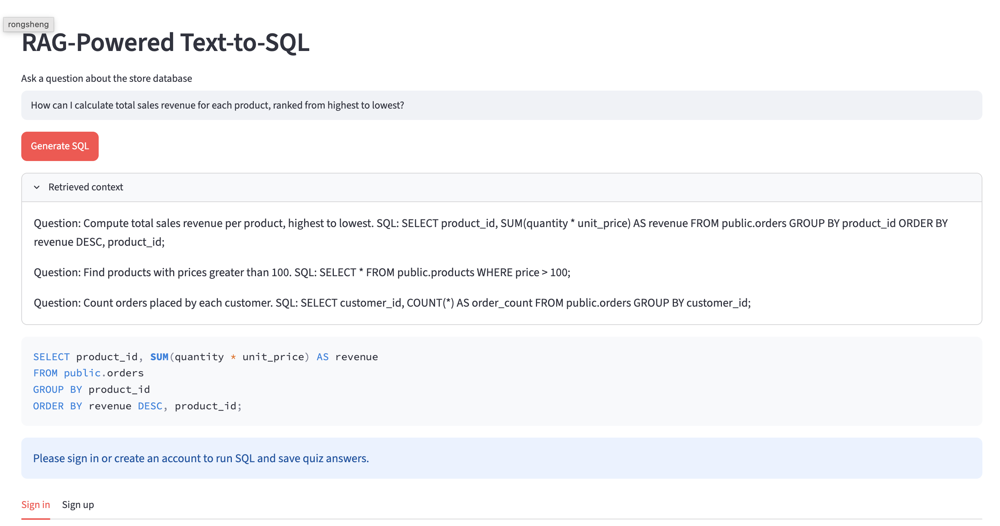

# IDS 706 Week 8 — RAG-Powered Text-to-SQL

A Streamlit application that extends the Week 7 SQL Quiz with Retrieval-Augmented Generation (RAG). Users can ask a natural-language question about the store database and receive PostgreSQL SQL generated from context retrieved from ChromaDB.

## Live application

**Deployed application:** Add the Streamlit Community Cloud URL here after deploying this repository.

**GitHub repository:** https://github.com/RoyceZhang/ids706-rag-text-to-sql

## RAG demonstration

Add the screenshot captured after generating SQL at `screenshots/rag-demo.png`, then this image will appear here:



The screenshot should show the question, retrieved context, and generated SQL.

## How the application works

1. The user enters a natural-language question in the Streamlit interface.
2. ChromaDB performs vector similarity retrieval over knowledge documents containing the PostgreSQL schema, join relationships, and few-shot question/SQL examples.
3. The application passes the retrieved context and question to OpenAI's `gpt-5-mini` model.
4. The model returns a PostgreSQL `SELECT` query, which the app displays.

The knowledge documents are upserted into a persistent ChromaDB collection named `sql_quiz_knowledge`. The app retrieves the three most relevant documents for each question. This is actual vector retrieval; the schema and examples are not simply inserted into every prompt without searching.

The application also retains the Week 7 SQL Quiz. After signing in, users can execute SQL against the hosted Supabase PostgreSQL database and save quiz answers. SQL generated by the RAG section is displayed for review; it is not automatically executed.

## Technology

- **Web app:** Streamlit
- **PostgreSQL and authentication:** Supabase
- **Vector database:** ChromaDB with persistent local storage
- **AI API:** OpenAI Responses API using `gpt-5-mini`
- **RAG knowledge:** store schema, relationships, and five few-shot SQL examples

## Run locally

### Requirements

- Python 3.11 or newer
- A provisioned Supabase PostgreSQL project for the Week 7 quiz features
- An OpenAI API key for SQL generation

### Setup

Clone this Week 8 repository and install dependencies:

```bash
git clone https://github.com/RoyceZhang/ids706-rag-text-to-sql.git
cd ids706-rag-text-to-sql
python3 -m venv .venv
source .venv/bin/activate       # macOS/Linux
python -m pip install -r requirements.txt
cp .streamlit/secrets.toml.example .streamlit/secrets.toml
```

Edit `.streamlit/secrets.toml` on your computer and replace the placeholders with your own Supabase and OpenAI credentials. The file is ignored by Git and must never be committed.

Required settings:

```toml
supabase_url = "https://YOUR_PROJECT_REF.supabase.co"
supabase_publishable_key = "YOUR_SUPABASE_PUBLISHABLE_OR_ANON_KEY"
db_host = "YOUR_SESSION_POOLER_HOST"
db_port = 5432
db_user = "quiz_reader.YOUR_PROJECT_REF"
db_password = "YOUR_PRIVATE_READER_PASSWORD"
db_name = "postgres"
openai_api_key = "YOUR_OPENAI_API_KEY"
```

Start the application:

```bash
python -m streamlit run app.py
```

Open `http://localhost:8501`, enter a question in **RAG-Powered Text-to-SQL**, and select **Generate SQL**. The retrieved context and generated SQL appear below the input. To use the original quiz features, sign in with a Supabase Auth account.

### Deploy

Deploy this repository from its `main` branch on Streamlit Community Cloud with `app.py` as the entry point. Add the same settings listed above in the app's **Settings → Secrets** area. After the app is live, replace the deployment placeholder at the top of this README with the public URL and test SQL generation on the deployed page.

## Project files

```text
.
├── app.py
├── db.py
├── rag.py
├── requirements.txt
├── .gitignore
└── .streamlit/
    └── secrets.toml.example
```

## Security

Never commit `.streamlit/secrets.toml`, API keys, database passwords, or other credentials. If a key is exposed, revoke it and create a replacement.

---

**Assignment:** IDS 706 · Week 8 Optional Assignment: Build a RAG-Powered Text-to-SQL Application
